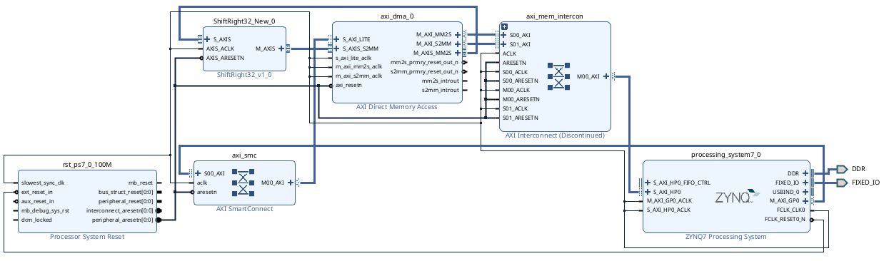

# AXI4-Stream Right-Shift IP on Zynq-7000 (PYNQ-Z2)

A custom AXI4-Stream IP core written in Verilog that takes each 32-bit word of a stream,
shifts it right by one bit (`data >> 1`), and passes it on. Packaged in Vivado, integrated
with an AXI DMA on a PYNQ-Z2, and verified on hardware from Python.

**Result:** 1024 / 1024 words matched the expected output on the board.

## Block diagram



Data path: **PS (DDR) → AXI DMA (MM2S) → this IP (S_AXIS → M_AXIS) → AXI DMA (S2MM) → PS (DDR)**

## How it works

- `ShiftRight32.v`: combinational user logic: `dout = din >> 1`. A constant shift is just
  wiring (no logic gates): input bit 1 goes to output bit 0, and the top output bit is tied to 0.
- `axis_shift_wrapper.v` (module `myipSHIFT32_New`): the AXI4-Stream wrapper that
  instantiates `ShiftRight32` and implements the handshake in one clocked block:
  1. Pulse `S_AXIS_TREADY` for one cycle when a word is waiting and the output register
     is empty (or being emptied this cycle).
  2. On the cycle where `TVALID && TREADY`, latch the shifted word into `M_AXIS_TDATA`,
     copy `TLAST` through, and raise `M_AXIS_TVALID`.
  3. Hold the word until the DMA raises `M_AXIS_TREADY`, then drop `M_AXIS_TVALID`.
- Reset is active-low (`AXIS_ARESETN`). Throughput is one word every two clock cycles.
- Interfaces: `S_AXIS` (slave), `M_AXIS` (master), `AXIS_ACLK`, `AXIS_ARESETN`.
  `AXIS_ACLK` is associated with both buses so Vivado's Connection Automation wires the
  clock and reset.

## Repository layout

```
rtl/         Verilog sources (ShiftRight32.v, axis_shift_wrapper.v)
bitstream/   design_1_AXISShift.bit and .hwh (matching names; PYNQ needs both)
notebook/    LE8.ipynb: PYNQ test with saved outputs
docs/        Block design screenshot
```

## Reproduce

1. Copy `bitstream/design_1_AXISShift.bit` and `.hwh` to the PYNQ-Z2 (same folder as the notebook).
2. Open `notebook/LE8.ipynb` and run all cells. The test fills a 1024-word buffer, runs it
   through the DMA loopback, and asserts `out == in >> 1`.

To rebuild from source: package `rtl/` as an IP in Vivado (Tools → Create and Package New IP →
Package a specified directory), infer `S_AXIS` / `M_AXIS` as `axis_rtl`, set
`ASSOCIATED_BUSIF = S_AXIS:M_AXIS` on the clock, add it to a block design with the Zynq PS
(S_AXI_HP0 enabled) and an AXI DMA (scatter-gather off), run Connection Automation, and
generate the bitstream.

## Tools

Vivado 2025.2 | PYNQ-Z2 (Zynq-7000) | Verilog HDL / Python / PYNQ / NumPy

## Notes

Built from Embedded Systems Design (ENGR431) @ University of Saint Thomas for the Fall '26. One thing I learned is that when "DMA" is implemented, the CPU programs the source / destination address, and a length, thereof the "DMA" engine begins then transfers that data over the bus and acts as the "master" of the hardware wires that is connected altogether.
